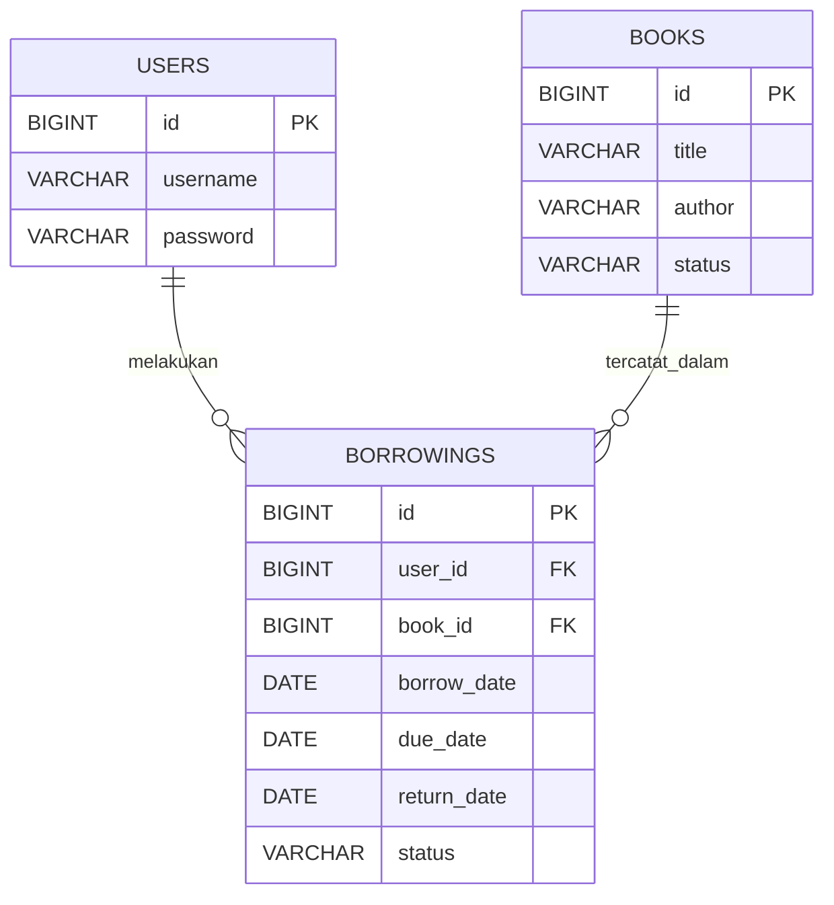

# ERD — Sistem Peminjaman Buku

## Keterangan relasi

- Satu pengguna (`users`) dapat memiliki banyak transaksi peminjaman (`borrowings`).
- Satu buku (`books`) dapat muncul dalam banyak transaksi peminjaman pada waktu yang berbeda.
- `borrowings.user_id` mengacu pada `users.id`.
- `borrowings.book_id` mengacu pada `books.id`.

## Catatan

Ini adalah rancangan awal berdasarkan template PRD. Cocokkan nama tabel, kolom, tipe data, dan aturan status dengan database proyek sebelum dijadikan dokumentasi final. Jika implementasi memakai tabel `loans`, ganti `borrowings` di diagram dan SQL agar konsisten.
