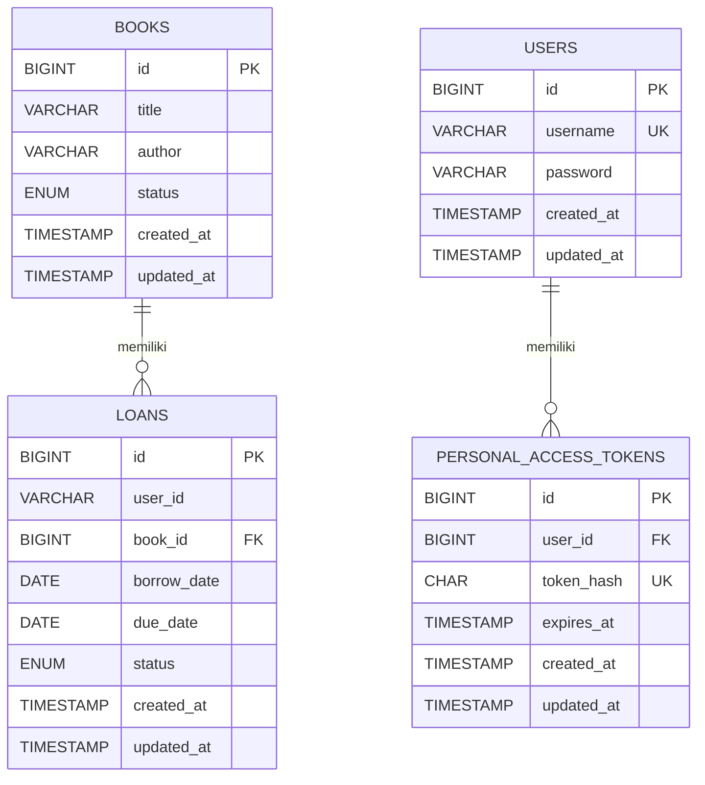

# ERD — Sistem Peminjaman Buku

## 1. Diagram Entity Relationship

## 2. Keterangan Entitas

- **users**: Menyimpan data akun pengguna, termasuk username dan password yang disimpan dalam bentuk hash.
- **books**: Menyimpan katalog buku, meliputi judul, penulis, dan status ketersediaan buku.
- **loans**: Menyimpan transaksi peminjaman buku, termasuk identitas pengguna, buku yang dipinjam, tanggal peminjaman, tanggal jatuh tempo, dan status transaksi.
- **personal_access_tokens**: Menyimpan data token autentikasi dalam bentuk hash, identitas pengguna, dan waktu kedaluwarsa token.

## 3. Keterangan Relasi

1. Satu buku dapat tercatat dalam banyak transaksi peminjaman pada waktu yang berbeda melalui relasi `books.id` dan `loans.book_id`.
2. Satu pengguna dapat memiliki banyak token autentikasi melalui relasi `users.id` dan `personal_access_tokens.user_id`.
3. Kolom `loans.book_id` merupakan foreign key yang mengacu pada `books.id`.
4. Kolom `personal_access_tokens.user_id` merupakan foreign key yang mengacu pada `users.id`.
5. Kolom `loans.user_id` menyimpan identitas pengguna pada transaksi, tetapi pada struktur database yang didokumentasikan belum memiliki foreign key ke `users.id`.

## 4. Catatan Struktur Database

Diagram ini disusun berdasarkan struktur database yang tercatat dalam laporan proyek. Tabel `loans` menggunakan status transaksi `active` dan `returned`, sedangkan tabel `books` menggunakan status ketersediaan `available` dan `borrowed`.

Tipe data, nama kolom, serta relasi perlu tetap mengikuti migration dan struktur MySQL aktual yang digunakan oleh proyek.
